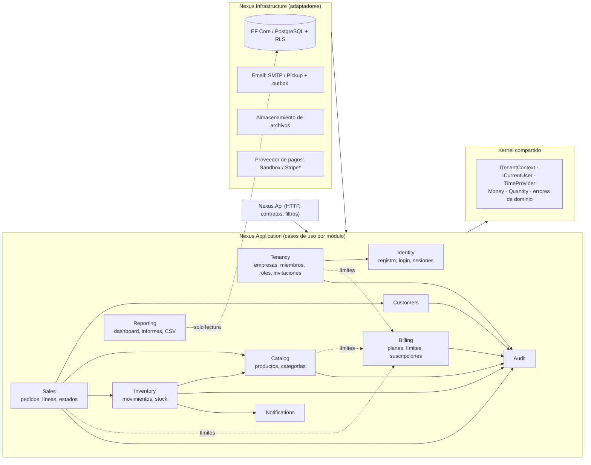
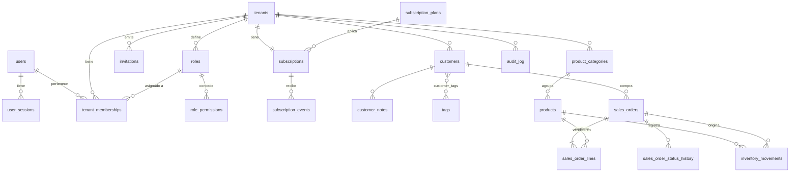

# NEXUS BUSINESS — Arquitectura (Fase 0)

> Estado: Fases 0–2 implementadas (2026-10-15). Las notas "*Implementación (Fase 2)*" recogen dónde el código concreta o ajusta este plan.
> Las decisiones relevantes están en [`docs/adr/`](adr/). Este documento es el mapa; los ADR son el porqué.

## 1. Resumen de la arquitectura

NEXUS BUSINESS es un **monolito modular** con un SPA separado:

| Pieza | Tecnología | Responsabilidad |
|---|---|---|
| `frontend/` | React 19 + TypeScript estricto + Vite, React Router, TanStack Query, RHF + Zod, Tailwind 4 + shadcn/ui, Recharts | Presentación. Nunca decide permisos, precios ni pertenencia a empresas. |
| `backend/` | ASP.NET Core (.NET 10 LTS), EF Core 10 + Npgsql, ASP.NET Core Identity, FluentValidation | Reglas de negocio, autorización, aislamiento multiempresa, persistencia. |
| PostgreSQL 17 | Base de datos única, esquema `public` | Integridad (FK compuestas por tenant), Row-Level Security como segunda barrera. |
| nginx | Contenedor `web` | Sirve el SPA y hace de proxy de `/api` → **un único origen** (cookies `SameSite=Strict`, sin CORS). |

Decisiones clave (detalle en los ADR):

1. **Monolito modular por capas** (`Domain` / `Application` / `Infrastructure` / `Api`) con módulos de negocio como carpetas verticales dentro de cada capa. Sin microservicios, sin Kubernetes, sin Redis en la v1. → [ADR-0001](adr/0001-monolito-modular.md)
2. **Sesión por cookie HttpOnly + antiforgery** con **almacén de sesiones en servidor** (tabla `user_sessions`), lo que permite listar y revocar sesiones individuales. → [ADR-0002](adr/0002-autenticacion-cookies-sesiones-servidor.md)
3. **Tenant en la ruta** (`/api/v1/tenants/{tenantId}/...`), validado contra una membresía activa en cada petición. Nunca se acepta un `TenantId` en el cuerpo. → [ADR-0003](adr/0003-resolucion-de-tenant.md)
4. **Aislamiento en profundidad**: filtro global de EF Core + interceptor de escritura + FK compuestas `(tenant_id, id)` + **RLS de PostgreSQL** con un rol de ejecución sin privilegios. → [ADR-0004](adr/0004-aislamiento-multiempresa.md)
5. **Permisos explícitos** agrupados en roles por empresa (5 roles de sistema + roles personalizados). Reglas anti-escalada en el servidor. → [ADR-0005](adr/0005-roles-y-permisos.md)
6. **Dinero en `decimal`/`numeric`**, redondeo por línea a la precisión ISO 4217 de la moneda de la empresa, `MidpointRounding.AwayFromZero`. → [ADR-0006](adr/0006-dinero-y-redondeo.md)
7. **Inventario como libro de movimientos** append-only + saldo cacheado actualizado con `UPDATE` condicional atómico dentro de la transacción de la venta; claves de idempotencia en operaciones de venta. → [ADR-0007](adr/0007-inventario-y-concurrencia.md)
8. **Pagos detrás de un puerto** (`IPaymentProvider`); proveedor `Sandbox` claramente identificado y deshabilitado en producción; webhooks verificados e idempotentes. → [ADR-0008](adr/0008-suscripciones-y-pagos.md)
9. **Auditoría explícita** escrita en la misma transacción que el cambio; tabla append-only a nivel de privilegios SQL. → [ADR-0009](adr/0009-auditoria.md)
10. **Migraciones controladas**: comando `migrate` separado que se ejecuta con el rol propietario; la API en producción nunca migra al arrancar. → [ADR-0010](adr/0010-migraciones-y-roles-de-base-de-datos.md)

El nombre comercial es configuración (`Branding:ProductName` en la API, `VITE_PRODUCT_NAME` en el SPA). `Nexus` es solo el nombre en clave del código (namespaces, proyectos) y no aparece en reglas de negocio ni en datos.

## 2. Módulos y dependencias



*Stripe (u otro) solo cuando existan credenciales y requisitos; ver ADR-0008.

Reglas de dependencia (verificadas con pruebas de arquitectura cuando son comprobables):

- `Domain` no referencia ningún otro proyecto ni EF Core.
- `Application` referencia `Domain` y las abstracciones de EF Core (no Npgsql, no ASP.NET Core).
- `Infrastructure` implementa los puertos de `Application`.
- `Api` es la única capa que conoce HTTP. Los controladores son finos: validan, llaman a un caso de uso, mapean a DTO.
- Entre módulos, la dirección es la del diagrama (sin ciclos). `Reporting` solo lee; nunca escribe.
- `Audit` es un sumidero: todos escriben en él, él no depende de nadie.

## 3. Modelo de datos inicial

Convenciones:

- Nombres `snake_case` en PostgreSQL (convención propia en `OnModelCreating`, sin dependencia extra).
- Claves `uuid` (v7, ordenables en el tiempo, generadas en la aplicación), también en `audit_log`: así los INSERT no necesitan `RETURNING`, que RLS comprobaría contra la política de lectura.
- Fechas `timestamptz` en UTC. Las fechas "de negocio" (agrupación por día) se calculan en la zona horaria de la empresa en el momento de la consulta.
- Toda tabla de negocio tiene `tenant_id uuid not null` y una **clave alternativa `(tenant_id, id)`**; las referencias entre tablas de negocio son **FK compuestas** `(tenant_id, x_id) → (tenant_id, id)`. Así la base de datos impide, por sí sola, que un pedido de la empresa A apunte a un cliente de la empresa B.
- Concurrencia optimista con la columna de sistema `xmin` (token de concurrencia de Npgsql) en agregados editables.
- Archivado con `archived_at timestamptz null` (nunca borrado físico de entidades referenciadas por ventas).
- Auditoría de fila: `created_at`, `created_by`, `updated_at`, `updated_by`.



### 3.1 Identidad y empresas (tablas globales o con política mixta)

| Tabla | Campos principales | Restricciones / notas |
|---|---|---|
| `users` (Identity) | `id`, `email`, `normalized_email`, `email_confirmed`, `password_hash`, `security_stamp`, `display_name`, `lockout_*`, `created_at` | `normalized_email` único. Sin `tenant_id`: un usuario puede pertenecer a varias empresas. |
| `user_sessions` | `id`, `user_id`, `ticket` (cifrado con Data Protection), `created_at`, `last_seen_at`, `expires_at`, `revoked_at`, `user_agent`, `ip_prefix` | FK `user_id` CASCADE. Índice `(user_id, revoked_at)`. La IP se guarda truncada (/24, /48). |
| `tenants` | `id`, `name`, `slug`, `legal_name`, `tax_id`, `email`, `phone`, dirección, `time_zone` (IANA), `currency` (ISO 4217), `locale` (BCP 47), `logo_file_id`, `allow_negative_stock`, `customer_duplicate_rule`, `status`, `xmin` | `slug` único (minúsculas, `[a-z0-9-]`). `currency` inmutable una vez existen ventas. |
| `tenant_memberships` | `id`, `tenant_id`, `user_id`, `role_id`, `status` (Active/Disabled), `joined_at`, `disabled_at` | Único `(tenant_id, user_id)`. FK compuesta `(tenant_id, role_id) → roles`. Una empresa siempre conserva al menos un Owner activo (regla de aplicación + prueba). |
| `roles` | `id`, `tenant_id`, `name`, `system_key` (owner, administrator, manager, employee, read_only o null), `description` | Único `(tenant_id, lower(name))` y `(tenant_id, system_key)`. Los roles de sistema no se borran; Owner no se edita. |
| `role_permissions` | `role_id`, `permission` | PK `(role_id, permission)`. El catálogo de permisos vive en código; la API rechaza valores desconocidos. |
| `invitations` | `id`, `tenant_id`, `email`, `role_id`, `token_hash` (SHA-256), `invited_by`, `expires_at`, `accepted_at`, `revoked_at` | Único parcial `(tenant_id, normalized_email)` donde está pendiente. El token en claro solo viaja en el correo. |

### 3.2 Clientes

| Tabla | Campos principales | Restricciones / notas |
|---|---|---|
| `customers` | `id`, `tenant_id`, `kind` (Person/Company), `name`, `legal_name`, `tax_id`, `email`, `normalized_email`, `phone`, dirección, `archived_at`, `xmin` | Índices `(tenant_id, normalized_email)`, `(tenant_id, tax_id)`, GIN `pg_trgm` sobre `name` para búsqueda. La regla anti-duplicados (`none` / `email` / `tax_id` / `email_or_tax_id`) es configuración de la empresa y se aplica bajo un `pg_advisory_xact_lock` por empresa. |
| `customer_notes` | `id`, `tenant_id`, `customer_id`, `body`, `author_id`, `created_at` | Notas internas; nunca se exportan en CSV. |
| `tags` / `customer_tags` | `tags(id, tenant_id, name, color)`; `customer_tags(tenant_id, customer_id, tag_id)` | Único `(tenant_id, lower(name))`. FK compuestas en ambos lados. |

### 3.3 Catálogo e inventario

| Tabla | Campos principales | Restricciones / notas |
|---|---|---|
| `product_categories` | `id`, `tenant_id`, `name`, `archived_at` | Único `(tenant_id, lower(name))`. Plana en la v1. |
| `products` | `id`, `tenant_id`, `kind` (Product/Service), `sku`, `name`, `description`, `category_id`, `unit`, `unit_price numeric(19,4)`, `cost numeric(19,4) null`, `tax_rate numeric(5,2)`, `track_inventory`, `stock_on_hand numeric(18,3)`, `min_stock numeric(18,3)`, `archived_at`, `xmin` | Único `(tenant_id, upper(sku))`. `CHECK (unit_price >= 0)`, `CHECK (kind = 'Service' → NOT track_inventory)`. `stock_on_hand` solo cambia junto con un movimiento. |
| `inventory_movements` | `id`, `tenant_id`, `product_id`, `type` (Initial, Adjustment, Sale, SaleReversal), `quantity_delta` (con signo), `stock_after`, `reason`, `sales_order_id null`, `occurred_at`, `created_by` | Append-only (sin UPDATE/DELETE para el rol de ejecución). Índice `(tenant_id, product_id, occurred_at desc)`. Invariante comprobada en pruebas: `Σ quantity_delta = stock_on_hand`. |

### 3.4 Ventas

| Tabla | Campos principales | Restricciones / notas |
|---|---|---|
| `sales_orders` | `id`, `tenant_id`, `number` (correlativo por empresa), `customer_id null`, `status` (Draft/Confirmed/Completed/Cancelled), `currency`, `subtotal`, `discount_total`, `tax_total`, `total`, `notes`, `confirmed_at`, `completed_at`, `cancelled_at`, `cancel_reason`, `created_by`, `xmin` | Único `(tenant_id, number)`. Importes `numeric(19,4)` ya redondeados a la precisión de la moneda. `customer_id` nulo = venta de mostrador. |
| `sales_order_lines` | `id`, `tenant_id`, `order_id`, `line_no`, `product_id`, `sku`, `product_name` (instantánea), `quantity`, `unit_price`, `discount_percent`, `tax_rate`, `line_subtotal`, `line_discount`, `line_tax`, `line_total` | FK compuesta al pedido (CASCADE solo mientras es borrador; la aplicación prohíbe borrar pedidos confirmados) y al producto (RESTRICT). `CHECK (quantity > 0)`, `CHECK (discount_percent between 0 and 100)`. |
| `sales_order_status_history` | `id`, `tenant_id`, `order_id`, `from_status`, `to_status`, `reason`, `changed_by`, `changed_at` | Append-only. |
| `tenant_counters` | `tenant_id`, `name`, `next_value` | Numeración sin huecos por empresa con `UPDATE … RETURNING` dentro de la transacción. |
| `idempotency_keys` | `tenant_id`, `key`, `user_id`, `request_hash`, `status_code`, `response_body jsonb`, `created_at` | PK `(tenant_id, key)`. Misma clave + otra petición → 422. Caducan a las 24 h (tarea en segundo plano). |

### 3.5 Auditoría, suscripciones y soporte

| Tabla | Campos principales | Restricciones / notas |
|---|---|---|
| `audit_log` | `id uuid` (v7), `tenant_id null`, `actor_user_id null`, `actor_type` (User/System), `action`, `entity_type`, `entity_id`, `occurred_at`, `correlation_id`, `metadata jsonb` | Solo `INSERT`/`SELECT` para el rol de ejecución. `tenant_id` nulo = evento de seguridad de cuenta (login, cambio de contraseña). `metadata` con lista blanca de campos: nunca contraseñas, tokens ni secretos. |
| `subscription_plans` | `id`, `code`, `name`, `price`, `currency`, `interval`, `max_users`, `max_products`, `max_orders_per_month`, `features text[]`, `provider_price_ref`, `is_active` | Catálogo global (sin tenant). Sembrado por migración. |
| `subscriptions` | `id`, `tenant_id` (único), `plan_id`, `status` (Trialing/Active/PastDue/Canceled), `current_period_start/end`, `cancel_at_period_end`, `provider`, `provider_customer_ref`, `provider_subscription_ref`, `xmin` | Una suscripción vigente por empresa. |
| `subscription_events` | `id`, `provider`, `provider_event_id`, `type`, `tenant_id null`, `received_at`, `processed_at`, `payload jsonb`, `error` | Único `(provider, provider_event_id)` → reentregas del webhook sin efectos duplicados. |
| `stored_files` | `id`, `tenant_id`, `purpose`, `content_type`, `size_bytes`, `sha256`, `storage_key`, `created_at` | Logos: PNG/JPEG/WebP, ≤ 512 KB, tipo verificado por *magic bytes*. SVG rechazado (XSS). |
| `email_outbox` | `id`, `to`, `subject`, `body_html`, `body_text`, `created_at`, `next_attempt_at`, `attempts`, `sent_at`, `last_error` | Se inserta en la transacción del caso de uso y lo envía un `BackgroundService`. El cuerpo se borra tras enviarlo (contiene enlaces con token). |
| `notifications` | `id`, `tenant_id`, `recipient_user_id`, `kind`, `title`, `link`, `created_at`, `read_at` | Alertas de stock bajo, invitaciones aceptadas, pagos fallidos. |

Reglas de borrado: CASCADE solo para hijos sin vida propia (sesiones de un usuario, permisos de un rol, líneas de un borrador). Todo lo referenciado por ventas o auditoría es RESTRICT + archivado.

## 4. Estrategia de aislamiento multiempresa

Detalle completo en [ADR-0003](adr/0003-resolucion-de-tenant.md) y [ADR-0004](adr/0004-aislamiento-multiempresa.md). Resumen de las capas, de fuera hacia dentro:

1. **Resolución**: el tenant viene de la ruta (`/api/v1/tenants/{tenantId}/…`). Un filtro de endpoint carga la membresía `(usuario autenticado, tenantId)`; si no existe, está deshabilitada o la empresa está suspendida → **404** (no se revela si la empresa existe). Con ella se construye un `ITenantContext` *scoped* e inmutable (tenant, usuario, rol, permisos efectivos).
2. **Autorización**: cada acción declara el permiso que exige (`[RequirePermission(Permissions.SalesCreate)]`); los permisos se leen de la base de datos en cada petición (revocación inmediata, sin claims cacheados en la cookie).
3. **Lectura (EF Core)**: filtro global con nombre sobre toda entidad `ITenantOwned`: `e.TenantId == tenantContext.TenantId`. Sin contexto, el filtro compara con `Guid.Empty` → **no devuelve nada** (falla cerrado). `IgnoreQueryFilters()` está prohibido fuera de una lista blanca comprobada por prueba.
4. **Escritura (EF Core)**: un interceptor de `SaveChanges` asigna `TenantId` en altas y rechaza modificaciones o borrados de entidades de otro tenant, y cualquier cambio de `TenantId`.
5. **Integridad (PostgreSQL)**: FK compuestas `(tenant_id, id)` impiden referencias cruzadas aunque haya un error en la aplicación.
6. **RLS (PostgreSQL)**: políticas `tenant_id = current_setting('app.tenant_id')::uuid` en todas las tablas de negocio, con `FORCE ROW LEVEL SECURITY`. La API se conecta con `nexus_app` (sin `BYPASSRLS`, no propietario). Un interceptor de conexión fija `app.tenant_id` y `app.user_id` con `set_config(…, false)` **en cada apertura** de conexión (con cadena vacía si no hay tenant → ninguna fila visible). Cubre especialmente las consultas SQL directas de informes, donde los filtros de EF no aplican.
7. **Procesos sin usuario** (webhooks, tareas en segundo plano): no tienen tenant implícito. Deben abrir un ámbito explícito `TenantScope.Begin(tenantId, actor: System)` por cada empresa que procesan; el ámbito queda auditado.
8. **Frontend**: todas las *query keys* empiezan por `['tenant', tenantId, …]`; al cambiar de empresa o cerrar sesión se ejecuta `queryClient.clear()`. Ocultar botones es comodidad, no seguridad.

Limitaciones conocidas (se documentan y prueban):

- Las tablas globales (`users`, `subscription_plans`) no tienen RLS por tenant; su acceso pasa por casos de uso. Políticas de lectura mixtas (Fase 2) para listar "mis empresas": `tenant_memberships` (`tenant_id = app.tenant_id OR user_id = app.user_id`), `tenants` (la propia o aquellas en las que el usuario tiene membresía) y `roles` (solo el rol que el usuario tiene en cada empresa). Las escrituras exigen siempre el tenant del contexto. `invitations` usa la política simple por tenant: antes de ser miembro, el invitado accede a través de un ámbito de sistema explícito.
- RLS no protege contra un administrador de base de datos ni contra el rol propietario (que solo usa el comando `migrate`).
- Un fallo de lógica *dentro* de una misma empresa (p. ej. un empleado viendo costes) lo cubren los permisos, no el aislamiento.

Pruebas obligatorias (Fase 2, y se amplían en cada módulo): para cada endpoint de recurso, un usuario de la empresa A recibe 404 al leer, editar, archivar o referenciar (p. ej. vender un producto de B) un recurso de B, incluso manipulando IDs en la ruta, el cuerpo o la *query string*; y una prueba a nivel SQL verifica que `nexus_app` sin `app.tenant_id` no ve filas.

## 5. Principales riesgos de seguridad

| # | Riesgo | Mitigación prevista | Fase |
|---|---|---|---|
| R1 | Fuga entre empresas (IDOR/BOLA) | Las 8 capas de §4; pruebas de acceso cruzado por endpoint | 2+ |
| R2 | Escalada de privilegios | No cambiar el propio rol; solo asignar roles con permisos ⊆ propios; solo un Owner nombra Owners; siempre ≥ 1 Owner; auditoría | 2 |
| R3 | Robo de sesión / CSRF | Cookie HttpOnly + Secure + SameSite=Strict, antiforgery de doble envío, sesiones revocables, rotación al iniciar sesión | 2 |
| R4 | Fuerza bruta / enumeración de cuentas | Rate limiting por IP, bloqueo de Identity, respuestas idénticas en registro/recuperación | 2 |
| R5 | Inventario inconsistente por concurrencia | `UPDATE` condicional atómico, orden de bloqueo por `product_id`, pruebas concurrentes reales | 4 |
| R6 | Ventas duplicadas por reintentos | Cabecera `Idempotency-Key` en creación/confirmación | 4 |
| R7 | Errores de redondeo / importes manipulados | Importes calculados solo en servidor con `decimal`; el cliente no envía totales | 4 |
| R8 | Webhooks falsificados o repetidos | Firma HMAC verificada sobre el cuerpo crudo, ventana de tiempo, unicidad `(provider, event_id)` | 6 |
| R9 | Elusión de límites del plan por concurrencia | Comprobación bajo bloqueo de la fila de suscripción | 6 |
| R10 | Tareas en segundo plano sin aislamiento | `TenantScope` explícito; sin tenant → RLS no devuelve filas | 2/6 |
| R11 | Caché del SPA mezclando empresas | Query keys con tenant, `clear()` en cambio/cierre, `Cache-Control: no-store` en la API | 2 |
| R12 | Subida de archivos maliciosos | Lista blanca por *magic bytes*, tamaño máximo, sin SVG, nombre generado, `nosniff`, `Content-Disposition` | 3 |
| R13 | Inyección de fórmulas en CSV | Prefijo `'` en celdas que empiezan por `= + - @ \t \r` | 5 |
| R14 | Datos personales en logs/auditoría | Logs estructurados sin cuerpos de petición; metadatos de auditoría con lista blanca; IP truncada | 1+ |
| R15 | Secretos en el repositorio | `.env` ignorado, User Secrets en desarrollo, variables de entorno en producción, validación de configuración al arrancar | 1 |
| R16 | Asignación masiva | DTO de entrada explícitos por caso de uso; nunca entidades en la API | 1+ |
| R17 | Fuga de contexto RLS entre conexiones del pool | `set_config` en **cada** apertura de conexión; prueba que alterna tenants sobre la misma conexión física | 2 |
| R18 | Cumplimiento fiscal | Los pedidos **no son facturas legales**. La facturación conforme (p. ej. Verifactu/TicketBAI en España) queda fuera del alcance y exige un análisis específico antes de anunciarse | — |

## 6. Estructura de carpetas

```text
nexus-business/
├── backend/
│   ├── Nexus.slnx
│   ├── Directory.Build.props / Directory.Packages.props   # versiones centralizadas
│   ├── src/
│   │   ├── Nexus.Domain/            # entidades, value objects (Money, Quantity), reglas puras
│   │   │   └── <Módulo>/            # Tenancy, Customers, Catalog, Inventory, Sales, Billing, Audit…
│   │   ├── Nexus.Application/       # casos de uso, DTO, validadores, puertos
│   │   │   ├── Abstractions/        # ITenantContext, ICurrentUser, IAppDbContext, IEmailSender…
│   │   │   └── <Módulo>/
│   │   ├── Nexus.Infrastructure/    # EF Core, RLS, Identity, email, archivos, pagos
│   │   │   └── Persistence/{Configurations,Migrations,Interceptors}
│   │   └── Nexus.Api/               # controladores, filtros, middleware, Program.cs
│   ├── tests/
│   │   ├── Nexus.UnitTests/         # dominio y aplicación, sin base de datos
│   │   └── Nexus.IntegrationTests/  # API real + PostgreSQL real (BD desechable por ejecución)
│   └── scripts/                     # test.sh (reintento ante Smart App Control)
├── frontend/
│   ├── src/
│   │   ├── app/          # providers, router, configuración de marca
│   │   ├── layouts/      # AppShell (sidebar, topbar), AuthLayout
│   │   ├── components/   # ui/ (shadcn) + compartidos (DataTable, PageHeader, EmptyState…)
│   │   ├── features/     # <módulo>/{api.ts, hooks, components, pages, schemas.ts}
│   │   ├── services/     # cliente HTTP tipado, errores, CSRF
│   │   ├── hooks/        # hooks genéricos
│   │   ├── lib/          # formato (moneda, fechas), utilidades
│   │   ├── types/        # tipos de la API
│   │   └── test/         # setup, MSW, utilidades de render
│   └── e2e/              # Playwright
├── docker/               # scripts de inicialización de PostgreSQL
├── docs/                 # ARCHITECTURE.md, adr/, OPERATIONS.md (Fase 7)
├── .github/workflows/ci.yml
├── docker-compose.yml
├── .env.example
└── README.md
```

No se crean carpetas vacías: cada módulo aparece cuando se implementa. Las validaciones Zod viven en cada `features/<módulo>/schemas.ts` (no hace falta una carpeta `validation/` global salvo que surjan esquemas compartidos).

## 7. Plan por fases

| Fase | Contenido | Verificación de salida |
|---|---|---|
| **0** Inspección y plan | Este documento + ADR | Revisión |
| **1** Fundación | Solución .NET por capas, Program.cs con *problem details*, manejo global de errores, logs JSON, correlación, health checks, rate limiting, OpenAPI, cabeceras de seguridad, configuración tipada validada al arrancar; DbContext + convención snake_case + migración base de privilegios; comando `migrate`; SPA con Tailwind/shadcn, tokens claro/oscuro, cliente HTTP tipado; Docker Compose (db + migrate + api + web); CI | Build + pruebas backend/frontend, `docker compose up` con health OK, e2e de humo |
| **2** Identidad y multitenancy | Registro, verificación de correo, login/logout, recuperación, sesiones en servidor y revocación; empresas, membresías, roles/permisos, invitaciones, selección de empresa; filtros + interceptores + FK compuestas + RLS; auditoría de seguridad; SPA: auth, selector de empresa, shell | Pruebas de aislamiento y de escalada **antes** de seguir |
| **3** Clientes y productos | Clientes (etiquetas, notas, duplicados, búsqueda, paginación), categorías, productos/servicios, logo de empresa, ajustes de empresa | Integración + aislamiento por endpoint + UI |
| **4** Inventario y ventas | Movimientos, ajustes, pedidos (borrador→confirmado→completado/cancelado), totales en servidor, idempotencia, numeración | Pruebas de concurrencia reales e idempotencia |
| **5** Dashboard e informes | KPIs reales con comparación de periodos, informes agregados en SQL, CSV, alertas de stock | Aislamiento de informes y exportaciones |
| **6** Auditoría y suscripciones | Visor de auditoría, planes y límites, proveedor Sandbox, webhooks firmados e idempotentes, pagos fallidos | Webhooks repetidos sin efectos duplicados, límites bajo concurrencia |
| **7** Endurecimiento y entrega | Revisión de dependencias y permisos, imágenes Docker, `OPERATIONS.md` (despliegue, migraciones, backup/restore, diagnóstico), e2e completos | Criterios de §8 |

## 8. Criterios de aceptación del MVP (Fases 1–6)

El MVP se considera funcional cuando se verifica, con pruebas automatizadas que comprueban resultados reales:

1. Frontend y backend compilan sin avisos; lint, typecheck y formato limpios.
2. Las migraciones se aplican desde cero sobre una base vacía y `has-pending-model-changes` está limpio.
3. Registro, verificación, login, logout, recuperación de contraseña y revocación de sesiones funcionan.
4. Un usuario de la empresa A no puede leer, modificar ni referenciar datos de la empresa B por ninguna vía (ruta, cuerpo, query string, informes, exportaciones).
5. Un usuario no puede cambiar su propio rol ni asignar permisos que no tiene; sin permiso, las operaciones administrativas devuelven 403.
6. Una venta confirmada descuenta stock con un movimiento trazable; ventas concurrentes no dejan stock negativo cuando la regla lo prohíbe; la cancelación genera los movimientos compensatorios.
7. Los totales se calculan en el servidor; los importes enviados por el cliente se ignoran.
8. Reintentos con la misma `Idempotency-Key` no duplican ventas; webhooks repetidos no duplican efectos.
9. Los límites del plan se aplican en el servidor.
10. El dashboard y los informes muestran datos reales y estados vacíos útiles.
11. No hay secretos en el repositorio; la configuración de producción se valida al arrancar.
12. E2E: login → crear empresa → cliente → producto → venta → movimiento de inventario → informe.

**MVP ≠ producción.** Antes de clientes reales hace falta además (Fase 7 y posteriores): CI ejecutado en GitHub, pruebas con un proveedor de pago real en modo test, SMTP real, revisión de seguridad externa, copias de seguridad automatizadas y probadas, monitorización/alertas y el análisis fiscal de R18.

## 9. Decisiones de producto tomadas por defecto (revisables)

| Tema | Decisión por defecto |
|---|---|
| Idioma de la interfaz | Español en la v1. El idioma de la empresa se guarda y se usa para formatos (números, fechas, moneda); traducción completa de la UI, posterior. |
| Impuestos | Tipo impositivo por producto, precios **sin impuestos**, impuesto calculado por línea. Informativo: no constituye factura legal (R18). |
| Stock negativo | Prohibido por defecto; configurable por empresa. |
| Ciclo del pedido | Borrador → Confirmado (descuenta stock) → Completado. Cancelación con motivo y permiso específico desde Confirmado o Completado (genera movimientos compensatorios). Nunca se edita un pedido confirmado. |
| Cobros de pedidos | Fuera de alcance de la v1 (no es un TPV ni contabilidad). |
| Cantidades | Decimales (3 cifras) con unidad (`ud`, `kg`, `h`…). |
| Verificación de correo | Obligatoria para crear empresas y aceptar invitaciones; desactivable solo en entornos de prueba. |
